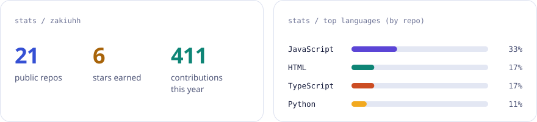
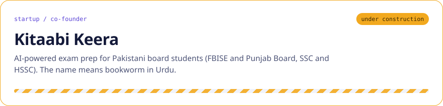
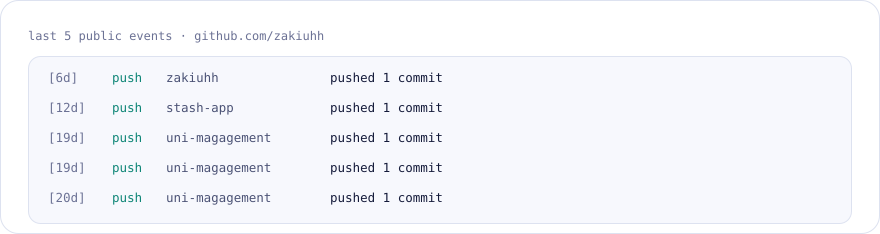
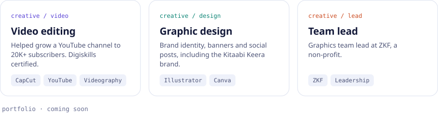
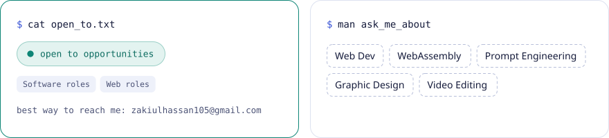

<!-- Built by scripts/build_assets.py. Edit the CONTENT section there, not the SVGs. -->

<picture><source media="(prefers-color-scheme: dark)" srcset="./assets/hero-dark.svg"></picture>

<picture><source media="(prefers-color-scheme: dark)" srcset="./assets/facts-dark.svg"></picture>

<h3><code>$ git log career --author zakiuhh</code></h3>

<picture><source media="(prefers-color-scheme: dark)" srcset="./assets/pipeline-dark.svg"></picture>

<h3><code>$ git status --short</code></h3>

<picture><source media="(prefers-color-scheme: dark)" srcset="./assets/metrics-dark.svg"></picture>

<h3><code>$ gh stats</code></h3>

<picture><source media="(prefers-color-scheme: dark)" srcset="./assets/stats-dark.svg"></picture>

<h3><code>$ cat ./startup.md</code></h3>

<picture><source media="(prefers-color-scheme: dark)" srcset="./assets/startup-dark.svg"></picture>

<h3><code>$ ls ./artifacts</code></h3>

<a href="https://github.com/zakiuhh/what-s-next"><picture><source media="(prefers-color-scheme: dark)" srcset="./assets/project-whatnext-dark.svg"></picture></a>
<a href="https://github.com/zakiuhh/coloristan"><picture><source media="(prefers-color-scheme: dark)" srcset="./assets/project-coloristan-dark.svg"></picture></a>
<a href="https://github.com/zakiuhh/zenith-cpp"><picture><source media="(prefers-color-scheme: dark)" srcset="./assets/project-zenith-dark.svg"></picture></a>
<a href="https://github.com/zakiuhh/deckyDocu"><picture><source media="(prefers-color-scheme: dark)" srcset="./assets/project-deckydocu-dark.svg"></picture></a>

<h3><code>$ tail -n 5 ~/activity.log</code></h3>

<picture><source media="(prefers-color-scheme: dark)" srcset="./assets/activity-dark.svg"></picture>

<h3><code>$ ls ./creative</code></h3>

<picture><source media="(prefers-color-scheme: dark)" srcset="./assets/creative-dark.svg"></picture>

<h3><code>$ cat ./open_to.txt</code></h3>

<picture><source media="(prefers-color-scheme: dark)" srcset="./assets/openwork-dark.svg"></picture>

<h3><code>$ curl zakiuhh.dev/endpoints</code></h3>

<a href="https://github.com/zakiuhh"><picture><source media="(prefers-color-scheme: dark)" srcset="./assets/endpoint-university-dark.svg"></picture></a>
<a href="https://www.linkedin.com/in/zakiuh"><picture><source media="(prefers-color-scheme: dark)" srcset="./assets/endpoint-linkedin-dark.svg"></picture></a>
<a href="https://github.com/zakiuhh"><picture><source media="(prefers-color-scheme: dark)" srcset="./assets/endpoint-github-dark.svg"></picture></a>
<a href="mailto:zakiulhassan105@gmail.com"><picture><source media="(prefers-color-scheme: dark)" srcset="./assets/endpoint-contact-dark.svg"></picture></a>

 

<picture><source media="(prefers-color-scheme: dark)" srcset="./assets/extras-dark.svg"></picture>

 

<code>$ exit</code> 
CS Student & Developer · Wah Cantt, Pakistan · <a href="mailto:zakiulhassan105@gmail.com">zakiulhassan105@gmail.com</a>

